<div dir="rtl">

# דוח שלב א – עיצוב, בנייה, אכלוס נתונים וגיבוי

**מגישים:** עקיבא כוכב, אליסף אוקנין · **קבוצה:** 8
**המערכת:** אקדמיה · **היחידה הנבחרת:** אגף רווחת הסטודנט (Welfare)

## תוכן עניינים

1. [מבוא](#מבוא)
2. [מסכי המערכת](#מסכי-המערכת)
3. [תרשים ERD](#תרשים-erd)
4. [תרשים DSD](#תרשים-dsd)
5. [החלטות עיצוב](#החלטות-עיצוב)
6. [מילון נתונים](#מילון-נתונים)
7. [הכנסת נתונים](#הכנסת-נתונים)
8. [גיבוי ושחזור](#גיבוי-ושחזור)
9. [קבצי השלב](#קבצי-השלב)

## מבוא

המערכת מנהלת את השירותים שאגף רווחת הסטודנט נותן לסטודנטים: מעונות, חדר אוכל, חדר כושר ושיעורי עזר.
נשמרים בה הסטודנטים, אנשי הצוות (אחראי מעונות וקופאים), בנייני המעונות והחדרים, שיבוצי הסטודנטים לחדרים,
התפריט והרכישות בחדר האוכל, מנויי חדר הכושר ושיעורי העזר בין סטודנטים.

הפעולות העיקריות: שיבוץ סטודנטים לחדרים ומעקב אחרי התפוסה, רישום רכישות בחדר האוכל,
מעקב אחרי מנויים פעילים, ותיעוד שיעורי עזר.
האפיון המלא נמצא בקובץ [אפיון מערכת.md](%D7%90%D7%A4%D7%99%D7%95%D7%9F%20%D7%9E%D7%A2%D7%A8%D7%9B%D7%AA.md).

## מסכי המערכת

אב הטיפוס נבנה ב-Google AI Studio:
https://ai.studio/apps/9d5f3995-79eb-4a04-adef-a010a644c196

**מסך ראשי** – סיכום ומצב כללי
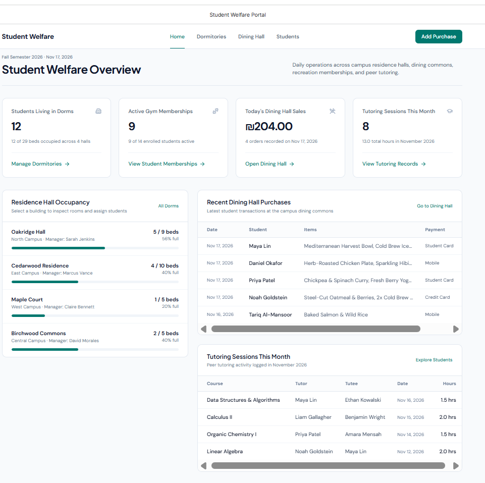

**מעונות** – בניינים, חדרים ושיבוץ סטודנטים
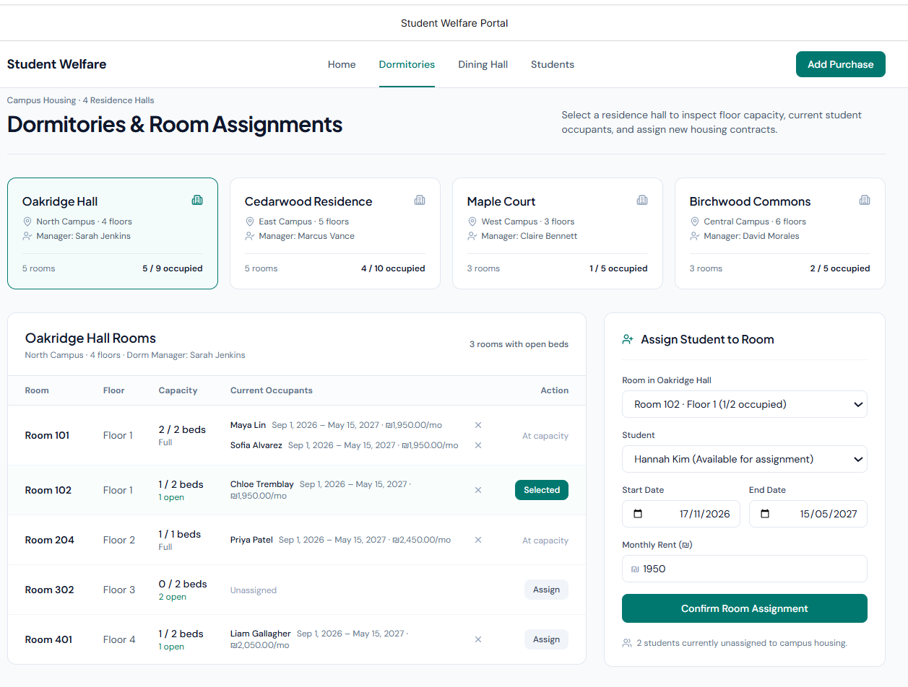

**חדר אוכל** – תפריט, רישום רכישה ורשימת רכישות
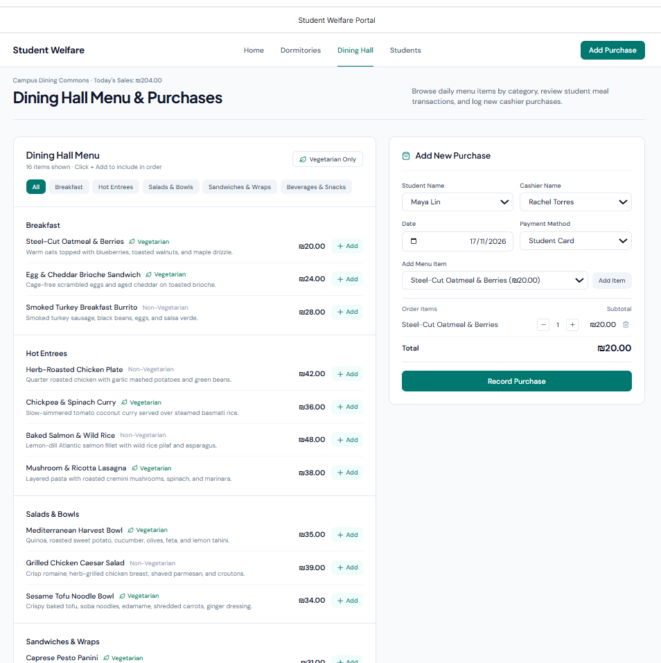
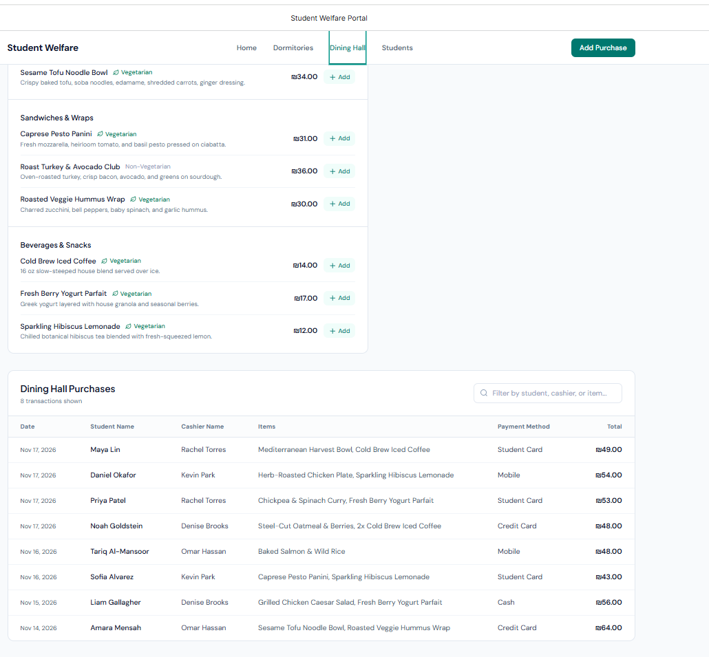

**סטודנטים** – פרטים, שיבוץ, מנוי ושיעורי עזר
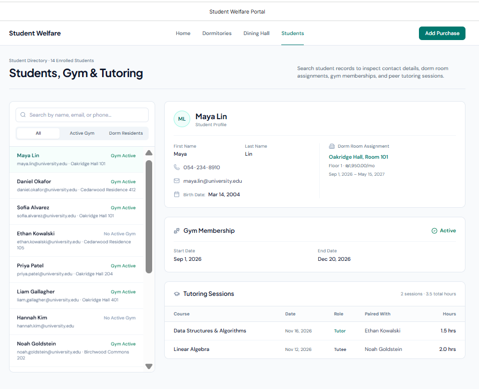
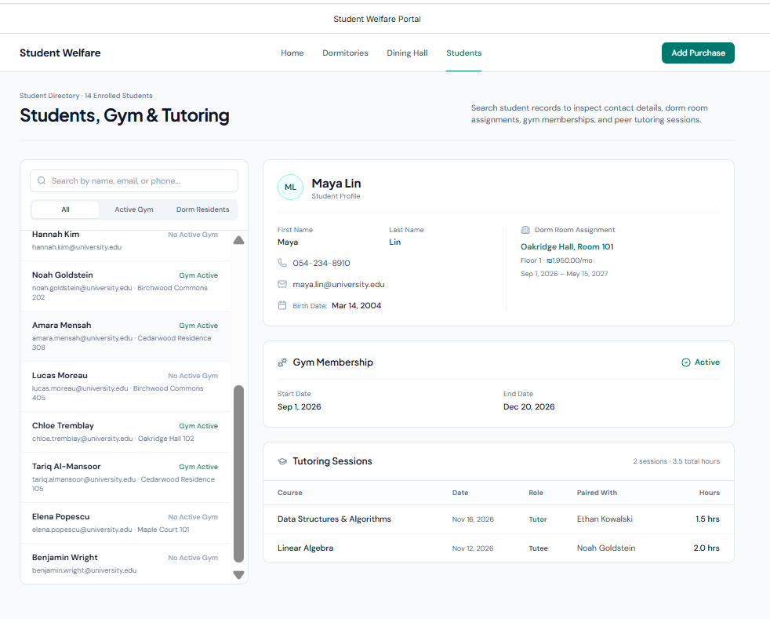

## תרשים ERD

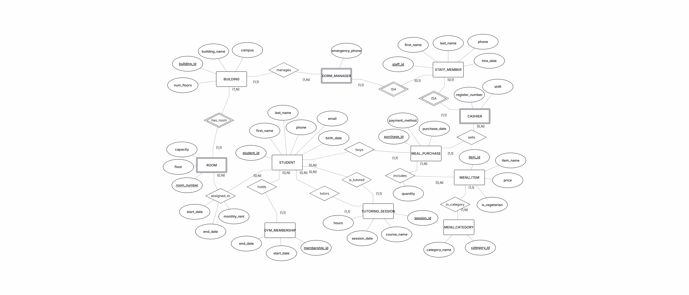

## תרשים DSD

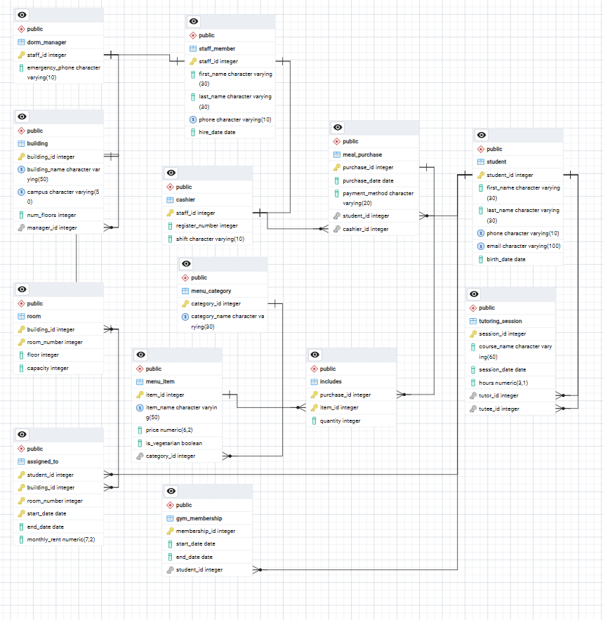

## החלטות עיצוב

- **הורשה:** אחראי מעונות וקופאי הם סוגים של איש צוות, ולכל אחד תכונות משלו.
  ב-ERDPlus אין סימון ייעודי להורשה, ולכן היא מסומנת כקשר מזהה בשם `ISA`.
  בטבלאות, המפתח של כל תת-סוג הוא גם מפתח זר לאיש הצוות.
- **ישות חלשה:** חדר מזוהה רק יחד עם הבניין שלו.
- **קשרי רבים-לרבים:** שיבוץ סטודנט לחדר (עם תאריכים ושכר דירה), ופריטים ברכישה (עם כמות).
- **קשר של ישות עם עצמה:** בשיעור עזר, גם המורה וגם הלומד הם סטודנטים.
- **הסרת טבלת סוג חדר:** סוג החדר (יחיד, זוגי וכו') קבע בעצמו את הקיבולת, וזה יצר כפילות וסתירות בנתונים. הטבלה הוסרה, והקיבולת נשמרת בחדר.
- **צורה נורמלית שלישית:** בכל טבלה כל השדות תלויים רק במפתח הראשי, ואין תלויות בין שדות שאינם מפתח.
- **אילוצים עיקריים:** סטודנט לא משובץ לשני חדרים באותה תקופה ולא מחזיק שני מנויים חופפים,
  תאריך סיום תמיד אחרי תאריך התחלה, וסטודנט לא מלמד את עצמו.

## מילון נתונים

13 טבלאות: 10 ישויות, 2 טבלאות מקשרות (רבים-לרבים) וטבלת סוגים אחת.
PK = מפתח ראשי, FK = מפתח זר. כל השדות הם שדות חובה (NOT NULL).

---

### STAFF_MEMBER – איש צוות
**מטרה:** כל עובדי האגף. ישות האב בהורשה.
| שדה | טיפוס | אילוצים | תיאור |
|---|---|---|---|
| staff_id | INT | PK, גדול מ-0 | מספר עובד |
| first_name | VARCHAR(30) | אותיות בלבד | שם פרטי |
| last_name | VARCHAR(30) | אותיות בלבד | שם משפחה |
| phone | VARCHAR(10) | ייחודי, מתחיל ב-0, 9-10 ספרות | טלפון |
| hire_date | DATE | בין 1970 להיום | תאריך תחילת עבודה |

**קשרים:** אב של DORM_MANAGER ושל CASHIER (הורשה, אחד-לאחד).

### DORM_MANAGER – אחראי מעונות
**מטרה:** איש צוות שמנהל בנייני מעונות.
| שדה | טיפוס | אילוצים | תיאור |
|---|---|---|---|
| staff_id | INT | PK, FK ל-STAFF_MEMBER | מספר העובד |
| emergency_phone | VARCHAR(10) | מתחיל ב-0, 9-10 ספרות | טלפון חירום |

**קשרים:** מנהל בניין אחד או יותר (BUILDING).

### CASHIER – קופאי
**מטרה:** איש צוות שמוכר בחדר האוכל.
| שדה | טיפוס | אילוצים | תיאור |
|---|---|---|---|
| staff_id | INT | PK, FK ל-STAFF_MEMBER | מספר העובד |
| register_number | INT | בין 1 ל-50 | מספר קופה |
| shift | VARCHAR(10) | morning / evening / night | משמרת |

**קשרים:** מוכר רכישות (MEAL_PURCHASE), אפס או יותר.

### STUDENT – סטודנט
**מטרה:** הסטודנטים שמקבלים שירותים מהאגף.
| שדה | טיפוס | אילוצים | תיאור |
|---|---|---|---|
| student_id | INT | PK, גדול מ-0 | מספר סטודנט |
| first_name | VARCHAR(30) | אותיות בלבד | שם פרטי |
| last_name | VARCHAR(30) | אותיות בלבד | שם משפחה |
| phone | VARCHAR(10) | ייחודי, מתחיל ב-0 | טלפון |
| email | VARCHAR(100) | ייחודי, בפורמט אימייל | אימייל |
| birth_date | DATE | אחרי 1940, גיל 16 לפחות | תאריך לידה |

**קשרים:** משובץ לחדרים (ASSIGNED_TO), מחזיק מנויים (GYM_MEMBERSHIP), קונה (MEAL_PURCHASE), מלמד ולומד בשיעורי עזר (TUTORING_SESSION). בכולם: אפס או יותר.

### BUILDING – בניין מעונות
**מטרה:** בנייני המעונות בקמפוסים.
| שדה | טיפוס | אילוצים | תיאור |
|---|---|---|---|
| building_id | INT | PK, גדול מ-0 | מספר בניין |
| building_name | VARCHAR(50) | ייחודי בתוך הקמפוס | שם הבניין |
| campus | VARCHAR(50) | | קמפוס |
| num_floors | INT | בין 1 ל-30 | מספר קומות |
| manager_id | INT | FK ל-DORM_MANAGER | האחראי על הבניין |

**קשרים:** מכיל חדרים (ROOM), מנוהל על ידי אחראי מעונות אחד.

### ROOM – חדר (ישות חלשה)
**מטרה:** חדר במעונות. מזוהה רק יחד עם הבניין שלו.
| שדה | טיפוס | אילוצים | תיאור |
|---|---|---|---|
| building_id | INT | PK, FK ל-BUILDING | הבניין |
| room_number | INT | PK (מפתח חלקי), גדול מ-0 | מספר החדר בבניין |
| floor | INT | בין 0 ל-30 | קומה |
| capacity | INT | בין 1 ל-6 | כמה סטודנטים יכולים לגור בחדר |

**קשרים:** שייך לבניין אחד. סטודנטים משובצים אליו (ASSIGNED_TO).

### ASSIGNED_TO – שיבוץ לחדר (רבים-לרבים)
**מטרה:** איזה סטודנט גר באיזה חדר, ובאיזו תקופה.
| שדה | טיפוס | אילוצים | תיאור |
|---|---|---|---|
| student_id | INT | PK, FK ל-STUDENT | הסטודנט |
| building_id | INT | PK, FK ל-ROOM | הבניין |
| room_number | INT | PK, FK ל-ROOM | החדר |
| start_date | DATE | PK, מ-2000 והלאה | תאריך כניסה |
| end_date | DATE | אחרי תאריך הכניסה | תאריך יציאה |
| monthly_rent | NUMERIC(7,2) | גדול מ-0, עד 10,000 | שכר דירה חודשי |

**אילוץ נוסף:** סטודנט לא יכול להיות משובץ לשני חדרים בתקופות חופפות.

### GYM_MEMBERSHIP – מנוי לחדר כושר
**מטרה:** מנויים של סטודנטים לחדר הכושר.
| שדה | טיפוס | אילוצים | תיאור |
|---|---|---|---|
| membership_id | INT | PK, גדול מ-0 | מספר מנוי |
| start_date | DATE | מ-2000 והלאה | תחילת המנוי |
| end_date | DATE | אחרי תאריך ההתחלה | סוף המנוי |
| student_id | INT | FK ל-STUDENT | בעל המנוי |

**אילוץ נוסף:** לסטודנט אין שני מנויים בתקופות חופפות.

### TUTORING_SESSION – שיעור עזר
**מטרה:** שיעורים שבהם סטודנט מלמד סטודנט אחר.
| שדה | טיפוס | אילוצים | תיאור |
|---|---|---|---|
| session_id | INT | PK, גדול מ-0 | מספר שיעור |
| course_name | VARCHAR(60) | לא ריק | הקורס |
| session_date | DATE | מ-2000 והלאה | תאריך השיעור |
| hours | NUMERIC(3,1) | גדול מ-0, עד 8 | משך בשעות |
| tutor_id | INT | FK ל-STUDENT | הסטודנט המלמד |
| tutee_id | INT | FK ל-STUDENT, שונה מהמלמד | הסטודנט הלומד |

### MENU_CATEGORY – קטגוריית מנה (טבלת סוגים)
**מטרה:** רשימת הקטגוריות בתפריט.
| שדה | טיפוס | אילוצים | תיאור |
|---|---|---|---|
| category_id | INT | PK, גדול מ-0 | מספר קטגוריה |
| category_name | VARCHAR(30) | ייחודי | שם הקטגוריה |

### MENU_ITEM – מנה
**מטרה:** המנות בתפריט חדר האוכל.
| שדה | טיפוס | אילוצים | תיאור |
|---|---|---|---|
| item_id | INT | PK, גדול מ-0 | מספר מנה |
| item_name | VARCHAR(50) | ייחודי | שם המנה |
| price | NUMERIC(6,2) | גדול מ-0, עד 500 | מחיר |
| is_vegetarian | BOOLEAN | ברירת מחדל: לא | האם צמחונית |
| category_id | INT | FK ל-MENU_CATEGORY | הקטגוריה |

### MEAL_PURCHASE – רכישה בחדר האוכל
**מטרה:** כל קנייה של סטודנט.
| שדה | טיפוס | אילוצים | תיאור |
|---|---|---|---|
| purchase_id | INT | PK, גדול מ-0 | מספר רכישה |
| purchase_date | DATE | בין 2000 להיום, ברירת מחדל: היום | תאריך |
| payment_method | VARCHAR(20) | cash / credit_card / student_card / mobile | אמצעי תשלום |
| student_id | INT | FK ל-STUDENT | הקונה |
| cashier_id | INT | FK ל-CASHIER | הקופאי שמכר |

### INCLUDES – פריט ברכישה (רבים-לרבים)
**מטרה:** אילו מנות נקנו בכל רכישה, ובאיזו כמות.
| שדה | טיפוס | אילוצים | תיאור |
|---|---|---|---|
| purchase_id | INT | PK, FK ל-MEAL_PURCHASE | הרכישה |
| item_id | INT | PK, FK ל-MENU_ITEM | המנה |
| quantity | INT | בין 1 ל-20, ברירת מחדל 1 | כמות |

## הכנסת נתונים

הנתונים הוכנסו בשלוש שיטות. הקובץ `insertTables.sql` מאחד את שלושתן לפי הסדר A, B, C, בתוך טרנזקציה אחת.
בכל טבלה יש לפחות 500 שורות, ובשתי טבלאות יותר מ-20,000 (30,000 רכישות ו-75,000 פריטים ברכישות).

### שיטה A – פקודות INSERT ידניות (תיקייה `ManualInserts`)

פקודות שנכתבו ביד: 12 קטגוריות התפריט הבסיסיות (ארוחת בוקר, מנה עיקרית, סלטים וכו').
שיטה B ממשיכה את הטבלה מהמספר הפנוי הבא (13 ואילך).

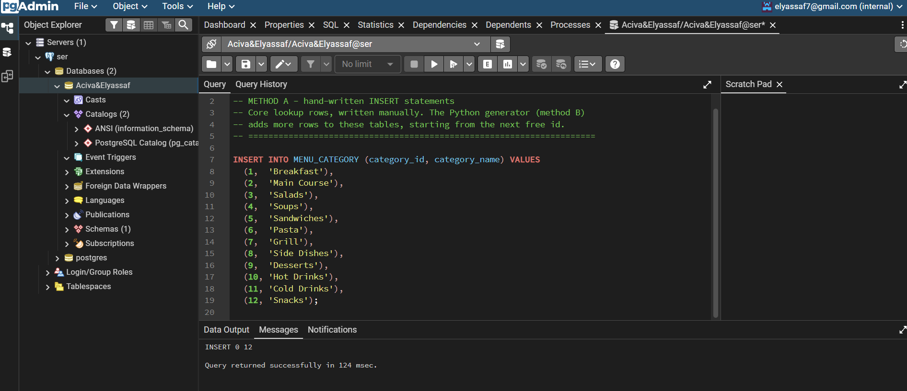

### שיטה B – סקריפט פייתון (תיקייה `Programing`)

הסקריפט `generate_data.py` מייצר פקודות INSERT לעשר טבלאות: אנשי צוות, אחראי מעונות, קופאים, סטודנטים,
בניינים, חדרים, שיבוצים, מנויים, קטגוריות ומנות.
הסקריפט שומר על כל האילוצים: טלפונים ייחודיים, חדר לא מתמלא מעבר לקיבולת, ואין שיבוצים או מנויים חופפים לאותו סטודנט.
`random.seed` קבוע, ולכן כל הרצה מייצרת בדיוק את אותם נתונים.
הפלט שלו נשמר ב-`generatedInserts.sql`, והוא גם בונה מחדש את `insertTables.sql`.

</div>

```
cd "שלב א"
python Programing/generate_data.py
```

<div dir="rtl">

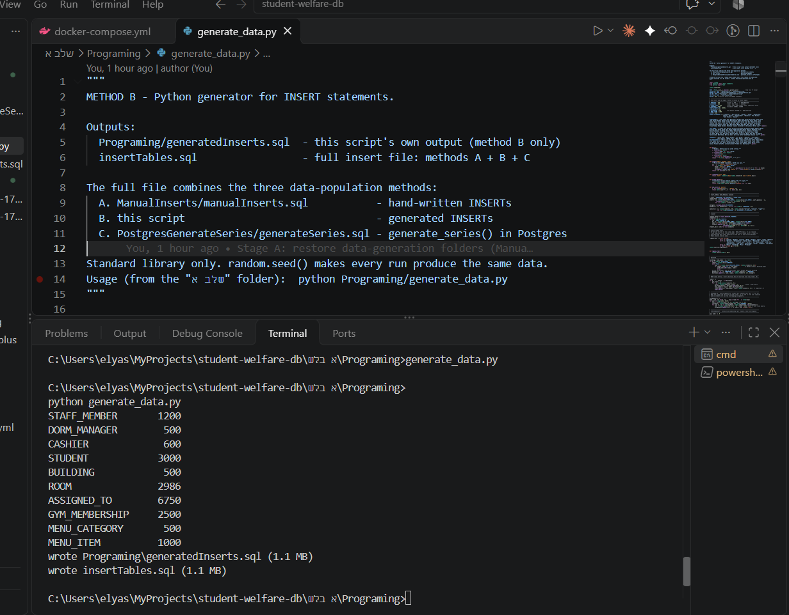

### שיטה C – generate_series בתוך PostgreSQL (תיקייה `PostgresGenerateSeries`)

שלוש הטבלאות הגדולות נוצרות בתוך מסד הנתונים עצמו, בעזרת `generate_series()` ו-`random()`:
5,000 שיעורי עזר, 30,000 רכישות, וכ-75,000 פריטים ברכישות (1-4 מנות שונות בכל רכישה).
`setseed` קבוע, ולכן התוצאה זהה בכל הרצה.

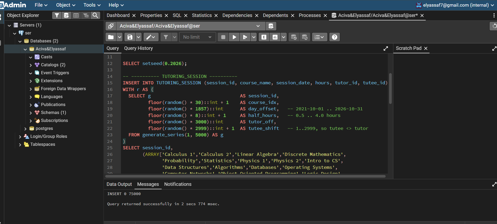

### ספירת השורות בכל טבלה

| טבלה | שורות | שיטה |
|---|---|---|
| STAFF_MEMBER | 1,200 | B |
| DORM_MANAGER | 500 | B |
| CASHIER | 600 | B |
| STUDENT | 3,000 | B |
| BUILDING | 500 | B |
| ROOM | 2,986 | B |
| ASSIGNED_TO | 6,750 | B |
| GYM_MEMBERSHIP | 2,500 | B |
| MENU_CATEGORY | 500 | A (12) + B (488) |
| MENU_ITEM | 1,000 | B |
| TUTORING_SESSION | 5,000 | C |
| MEAL_PURCHASE | 30,000 | C |
| INCLUDES | 75,000 | C |

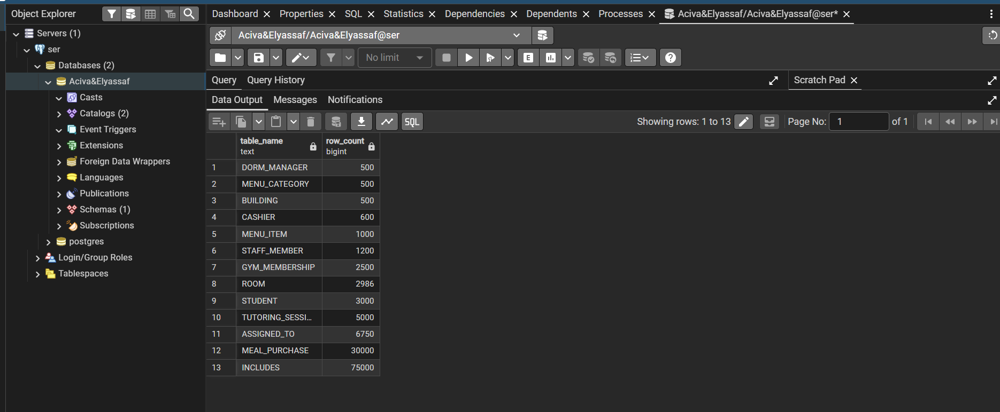

## גיבוי ושחזור

שני גיבויים מ-22.11.2026, בשתי שיטות. בדקנו את שני הקבצים עם `pg_restore --list`, ובשניהם יש את הנתונים של כל 13 הטבלאות.

1. **שורת פקודה** (`pg_dump`, הורץ מתוך cmd בתיקייה הראשית): `backup_2026-11-22.backup`

</div>

```
docker exec PostgreSQL_DB pg_dump -U "Aciva&Elyassaf" -d "Aciva&Elyassaf" -F c > "שלב א\backup_2026-11-22.backup"
```

<div dir="rtl">

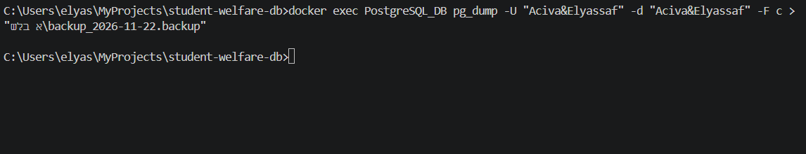

2. **pgAdmin** (Backup מתוך הממשק, בפורמט Custom): `backup_2026-11-22_pgadmin.backup`

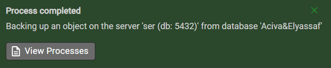

### שחזור על מחשב אחר

הגיבוי שוחזר על מחשב שני למסד ריק, ובדקנו בעזרת `selectAll.sql` שכל הטבלאות וכל השורות קיימות.

</div>

```
docker cp "backup_2026-11-22.backup" PostgreSQL_DB:/tmp/backup.backup
docker exec PostgreSQL_DB createdb -U welfare_user welfare_restore
docker exec PostgreSQL_DB pg_restore -U welfare_user -d welfare_restore --no-owner --no-privileges /tmp/backup.backup
```

<div dir="rtl">

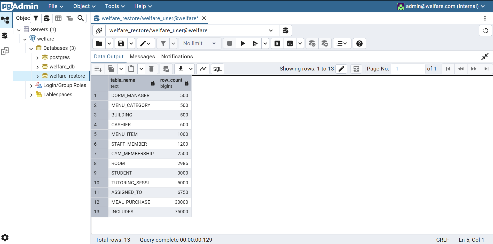

## קבצי השלב

| קובץ | תוכן |
|---|---|
| `createTables.sql` | יצירת כל הטבלאות והאילוצים |
| `dropTables.sql` | מחיקת כל הטבלאות בסדר הנכון |
| `insertTables.sql` | הכנסת הנתונים (שלוש השיטות יחד) |
| `ManualInserts/` | שיטה A – פקודות INSERT ידניות |
| `Programing/` | שיטה B – סקריפט הפייתון והפלט שלו |
| `PostgresGenerateSeries/` | שיטה C – generate_series |
| `selectAll.sql` | שליפה מכל הטבלאות וספירת שורות |
| `welfare_ERD.erdplus`, `welfare_ERD.png` | תרשים ERD |
| `welfare_DSD.png` | תרשים DSD |
| `אפיון מערכת.md` | מסמך האפיון |
| `screens/` | צילומי המסכים |
| `backup_2026-11-22.backup`, `backup_2026-11-22_pgadmin.backup` | קובצי הגיבוי |

</div>
